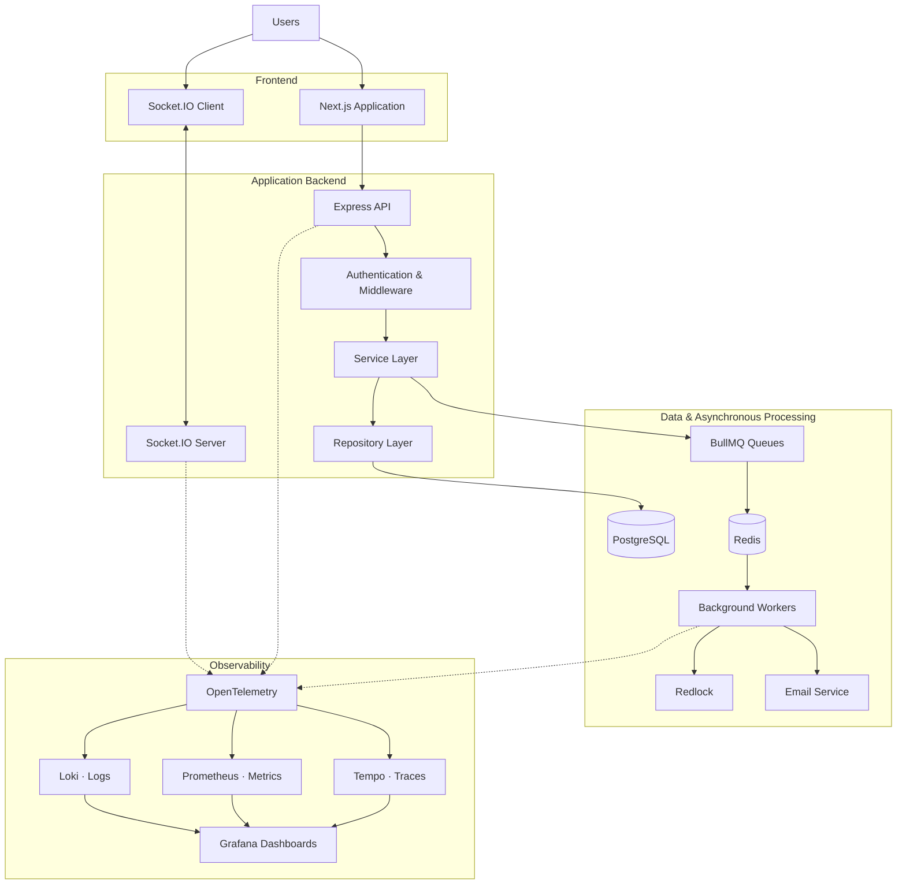
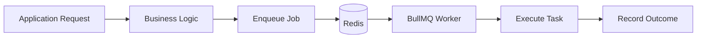

<div align="center">

#  Relay

### Chat. Collaborate. Get More Done.

**A collaborative workspace built for modern teams, combining real-time communication, collaborative documents, video calling, and AI-powered productivity.**

[🎬 Watch Demo](#-product-demo) · [✨ Features](#-key-features) · [🏗️ Architecture](#️-system-architecture) · [⚙️ Local Setup](#️-getting-started)

<!-- <br/> -->

<!-- Replace this with a link to your Relay logo or a repository-hosted image. -->
<!--  -->

<!-- <br/> -->


</div>

---

## 🎬 Product Demo

Get a firsthand look at **Relay** — a collaborative workspace built to bring team communication, productivity, and AI together.

<div align="center">

<a href="https://youtu.be/8CgwapcLofM">
  
</a>

### ▶️ [Watch Relay in Action](https://youtu.be/8CgwapcLofM)

*Explore Relay's workspace, collaboration features, and AI-powered experience in this product walkthrough.*

</div>

---

## 📖 About the Project

Relay is a full-stack collaboration platform designed to bring team communication and productivity into a unified workspace.

Rather than treating messaging, collaboration, and productivity as disconnected experiences, Relay brings them together in a single application with a foundation for AI-powered workflows.

Beyond the product experience, Relay is an engineering project focused on **type safety, asynchronous processing, real-time communication, distributed coordination, and end-to-end observability**.

The backend is designed around modular application layers, while its infrastructure incorporates background workers, Redis-backed queues, distributed locking, and telemetry pipelines for monitoring application health and performance.

### 🎯 Engineering Objectives

- **Real-time collaboration:** Enable responsive communication and shared workspace experiences.
- **Type-safe development:** Use TypeScript across the application to improve consistency between components and system boundaries.
- **Asynchronous processing:** Offload background tasks to dedicated workers rather than blocking request handling.
- **Distributed coordination:** Use distributed locking where concurrent operations require coordination.
- **Production-oriented observability:** Collect traces, metrics, and logs to investigate performance issues and application failures.
- **Operational visibility:** Build custom dashboards to make application health and latency measurable.

---

## ✨ Key Features

### 💬 Real-Time Communication
- Workspace-based communication and channel organization.
- Direct messaging and threaded discussions.
- Real-time message delivery using Socket.IO.
- A shared communication environment for team collaboration.

### 🏢 Collaborative Workspaces
- Workspace creation and membership management.
- Channel-based organization.
- Workspace navigation and member collaboration.
- A modular foundation for expanding collaborative functionality.

### 📝 Collaborative Productivity
- Collaborative document functionality.
- Video-calling capabilities.
- A unified interface for communication and collaborative work.

### 🤖 RelayAI
- AI-assisted interactions integrated into the Relay experience.
- Model-backed conversational functionality.
- An extensible foundation for future AI-powered workflows.

### 🔐 Authentication and Account Management
- JWT-based authentication.
- Password hashing and account security.
- Email-based account workflows.
- Background processing for supported email notifications.

### ⚙️ Background Processing
- Redis-backed asynchronous job queues using BullMQ.
- Worker-based task execution.
- Distributed locking using Redlock for supported coordination requirements.
- Queue monitoring through Bull Board.

### 📊 Observability and Monitoring
- Distributed tracing with OpenTelemetry.
- Metrics collection and visualization.
- Centralized log aggregation.
- Custom Grafana dashboards for monitoring service health and performance.
- Trace-to-log investigation workflows.

---

## 🏗️ System Architecture

Relay uses a layered backend architecture with dedicated responsibilities for HTTP handling, business logic, data access, and asynchronous processing.

### High-Level Architecture



*Conceptual architecture overview. Exact telemetry exporters, instrumentation coverage, and data-flow details depend on the deployed configuration.*

### Backend Design

The backend separates application responsibilities into distinct layers:

| Layer | Responsibility |
|---|---|
| Controllers | Handle HTTP requests, validate inputs, and return responses. |
| Services | Implement application use cases and business logic. |
| Repositories | Encapsulate database access and persistence operations. |
| Middleware | Handle cross-cutting concerns such as authentication and request processing. |
| Publishers and subscribers | Support event-driven communication where implemented. |
| Queues and workers | Process background jobs asynchronously. |
| Observability | Collect telemetry to support monitoring and troubleshooting. |

This separation makes individual responsibilities easier to understand, maintain, and extend without concentrating the entire application in a single layer.

---

## ⚡ Advanced Engineering

This is where Relay goes beyond a typical CRUD application.

### 1. End-to-End TypeScript

TypeScript is used across the application to provide compile-time type checking and a more consistent development experience.

Key benefits include:

- Explicit contracts between application layers.
- Type-safe request and response handling where defined.
- Improved maintainability as application complexity grows.
- Reduced reliance on loosely typed data passing between components.

### 2. Real-Time Communication with Socket.IO

Socket.IO powers real-time communication between clients and the server.

The event-driven communication model supports interactive collaboration experiences without requiring clients to repeatedly poll the server for new messages.

The implementation also provides a foundation for extending real-time communication to additional workspace features.

### 3. Asynchronous Processing with BullMQ and Redis

Time-consuming background operations can introduce unnecessary latency when performed directly within an HTTP request.

Relay uses BullMQ with Redis-backed queues to support asynchronous task processing.



**Why this matters:**

- Separates background work from request-response handling.
- Allows workers to process jobs independently of the API request lifecycle.
- Provides queue-level mechanisms for managing job execution and retries when configured.
- Creates a foundation for scaling background processing independently.

### 4. Distributed Locking with Redlock

When multiple workers or processes can attempt the same coordination-sensitive operation, concurrent execution may produce inconsistent results.

Relay incorporates Redlock for distributed locking around operations that require coordination.

Distributed locking helps coordinate access to shared resources across participating processes, subject to the lock's configuration, expiry, and failure-handling behavior.

It complements queue-based processing rather than replacing it: BullMQ manages jobs, while Redlock addresses specific coordination requirements.

### 5. Queue Monitoring with Bull Board

Background jobs need operational visibility, not just implementation.

Bull Board provides a dashboard for inspecting supported BullMQ queues and their job states.

It helps developers investigate queued, active, completed, and failed jobs, making background-processing issues easier to diagnose.

### 6. Email Workflow Testing with MailHog

Email workflows are difficult to develop and verify when every test requires sending a real email.

MailHog provides a local SMTP testing environment that captures outgoing messages for inspection.

This enables developers to verify email content, links, and notification workflows during development without delivering test messages to real recipients.

### 7. End-to-End Observability with OpenTelemetry and Grafana

Relay incorporates an observability pipeline designed to make application behavior measurable and failures easier to investigate.

The monitoring stack brings together three essential signals:

| Signal | Technology | Purpose |
|---|---|---|
| Distributed traces | OpenTelemetry + Grafana Tempo | Follow requests across instrumented application components. |
| Metrics | Prometheus | Measure request rates, errors, latency, and other instrumented behavior. |
| Logs | Grafana Loki | Centralize logs for searching and troubleshooting. |
| Visualization | Grafana | Explore telemetry through dashboards and correlated views. |

#### Custom RED Dashboards

Relay includes custom Grafana dashboards built around the RED methodology:

- **Rate:** How many requests the application handles.
- **Errors:** How many requests fail.
- **Duration:** How long requests take to complete.

Latency monitoring includes p95 and p99 percentiles, which help reveal slow requests that average latency alone can hide.

#### Trace-to-Log Investigation

Correlating traces with logs provides a more useful debugging workflow than inspecting either signal in isolation.

A typical investigation looks like this:

```text
Elevated API Latency
        |
        v
Inspect RED Dashboard
        |
        v
Identify Slow Request
        |
        v
Inspect Distributed Trace
        |
        v
Correlate Relevant Logs
        |
        v
Investigate the Bottleneck
```

This makes it possible to move from an observed performance issue toward the underlying cause, provided the relevant services are instrumented and trace context is propagated correctly.

---

## 🛠️ Technology Stack

| Category | Technologies |
|---|---|
| Frontend | Next.js, React, TypeScript |
| Backend | Node.js, Express, TypeScript |
| Database | PostgreSQL, Prisma ORM |
| Caching & Queue Infrastructure | Redis, BullMQ |
| Real-Time Communication | Socket.IO |
| Distributed Coordination | Redlock |
| Email Testing | MailHog |
| Observability Instrumentation | OpenTelemetry |
| Distributed Tracing | Grafana Tempo |
| Metrics | Prometheus |
| Log Aggregation | Grafana Loki |
| Dashboards | Grafana |
| Queue Monitoring | Bull Board |
| AI Integration | Groq API |
| Payments | Razorpay |

*The table describes the technologies used or integrated into Relay's broader development. Individual components may have different setup requirements or deployment status.*

---

## 📸 Application Screenshots

A quick look at Relay's workspace, real-time chat, AI experience, and observability tooling. Screenshots are intentionally displayed at a smaller width with a subtle border and spacing for easier reading.

### Workspace

<div align="center">
  <table border="1" cellpadding="8" cellspacing="0">
    <tr>
      <td align="center">
        
      </td>
    </tr>
  </table>
</div>

<br/>

### Real-Time Chat

<div align="center">
  <table border="1" cellpadding="8" cellspacing="0">
    <tr>
      <td align="center">
        
      </td>
    </tr>
  </table>
</div>

<br/>

### RelayAI

<div align="center">
  <table border="1" cellpadding="8" cellspacing="0">
    <tr>
      <td align="center">
        
      </td>
    </tr>
  </table>
</div>

<br/>

### Observability Dashboard

<div align="center">
  <table border="1" cellpadding="8" cellspacing="0">
    <tr>
      <td align="center">
        
      </td>
    </tr>
  </table>
</div>

<br/>

---

## ⚙️ Getting Started

Follow these steps to run the project locally.

### Prerequisites

Install or configure the following:

- Node.js and npm.
- PostgreSQL.
- Redis.
- Git.

MailHog, the observability stack, and other infrastructure components are required only when running the corresponding workflows.

### 1. Clone the Repository

```bash
git clone <YOUR_REPOSITORY_URL>
cd RelayProject
```

### 2. Install Dependencies

Install dependencies for the frontend and backend separately, according to the repository structure.

```bash
cd backend
npm install
```

For the frontend:

```bash
cd ../frontend
npm install
```

### 3. Configure Environment Variables

Create the required environment files using the project's example configuration, if available.

The backend configuration will typically need values for:

```env
DATABASE_URL="your-postgresql-connection-string"
JWT_SECRET="your-development-secret"
REDIS_HOST="localhost"
REDIS_PORT="6379"
```

Additional variables may be required for email, AI, payments, telemetry, and other integrations.

Use the actual environment variable names defined by the application. Never commit real credentials, API keys, or production secrets.

### 4. Configure the Database

From the backend directory, install the dependencies and apply the committed Prisma migrations:

```bash
npx prisma migrate deploy --config=src/prisma.config.ts
```

Validate the schema if needed:

```bash
npx prisma validate --config=src/prisma.config.ts
```

The database connection must point to an accessible PostgreSQL instance.

### 5. Start the Application

Start the frontend and backend using the scripts defined in their respective `package.json` files.

For example:

```bash
# Terminal 1 — Backend
cd backend
npm run dev
```

```bash
# Terminal 2 — Frontend
cd frontend
npm run dev
```

The exact script names and required environment variables depend on the current repository configuration.

### 6. Start Supporting Infrastructure

Start Redis and any other required services before using their associated functionality.

For local development, configure MailHog if you want to inspect outgoing test emails. Start the observability stack if you want to inspect traces, metrics, logs, and dashboards.

Refer to the relevant configuration files and documentation for the exact commands and service endpoints.

---

## 🗺️ Engineering Roadmap

Relay is being developed as an extensible collaboration platform, with room to evolve across several areas.

- [x] Workspace-based collaboration.
- [x] Real-time communication.
- [x] Asynchronous job processing with BullMQ and Redis.
- [x] Distributed locking for supported workflows.
- [x] Queue monitoring with Bull Board.
- [x] OpenTelemetry-based observability and custom Grafana dashboards.
- [ ] Further expansion of AI-assisted workflows.
- [ ] Additional integrations and productivity capabilities.
- [ ] Continued improvements to reliability, scalability, and operational tooling.

*The roadmap reflects intended areas of continued development, not guaranteed delivery dates.*

---

## 💡 Engineering Takeaways

Building Relay has provided hands-on experience with the challenges of developing and operating a multi-component application.

The project explores several engineering concerns beyond implementing product features:

- **Architecture:** Separating HTTP handling, business logic, persistence, and background execution.
- **Concurrency:** Coordinating operations across participating workers and processes.
- **Reliability:** Designing asynchronous workflows and investigating failed jobs.
- **Performance:** Measuring request latency and identifying slow operations.
- **Observability:** Connecting metrics, traces, and logs to improve debugging.
- **Developer experience:** Using local email testing and operational dashboards to shorten troubleshooting cycles.
- **Type safety:** Applying TypeScript to maintain clearer contracts throughout the application.

These concerns shape Relay's architecture and provide a foundation for continued engineering improvements.

---

## 👨‍💻 Author

**Shubham Negi**

Full-Stack Development · Backend Engineering · AI Engineering

If you're a recruiter, developer, or engineering enthusiast interested in the project, feel free to explore the repository and watch the product demo.

---

<div align="center">

### Relay — Chat. Collaborate. Get More Done.

*Built with TypeScript and a focus on collaboration, engineering quality, and observability.*

</div>